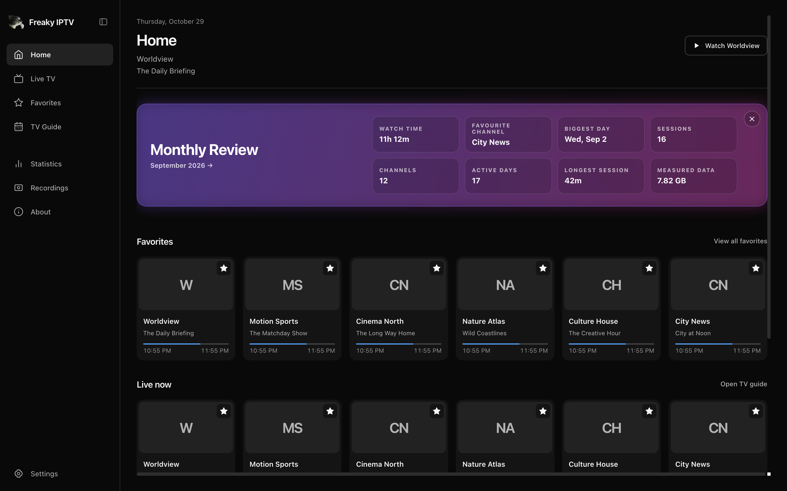
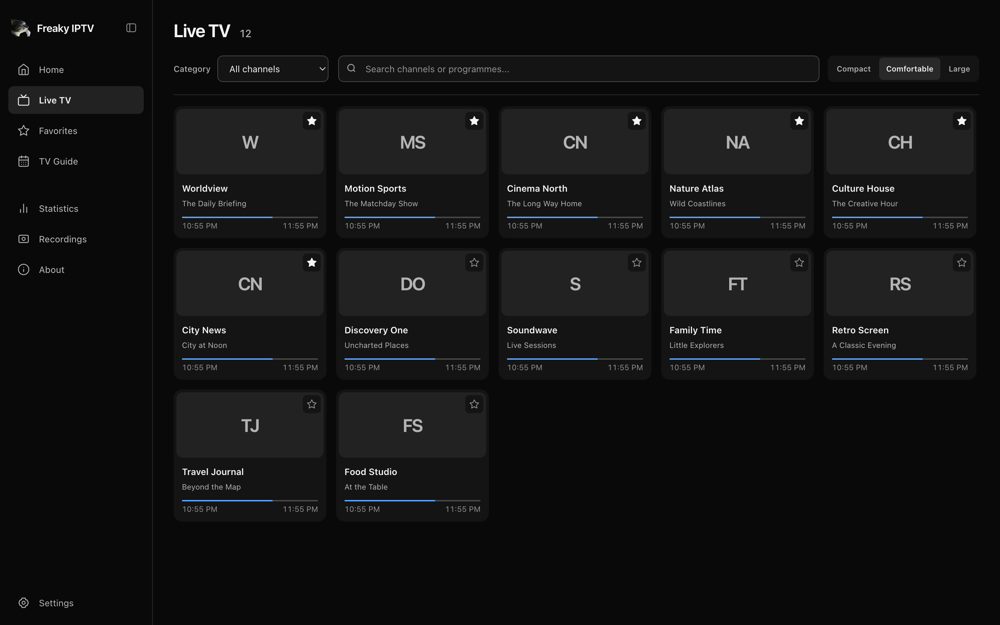
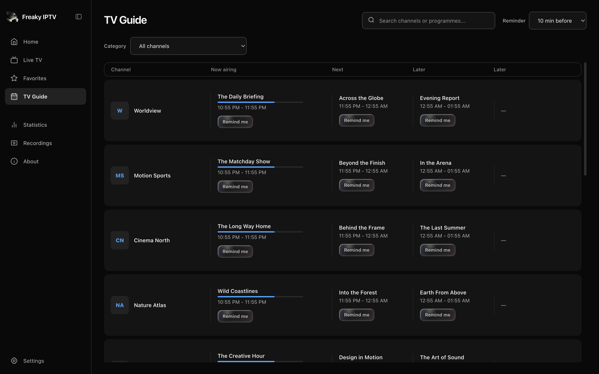
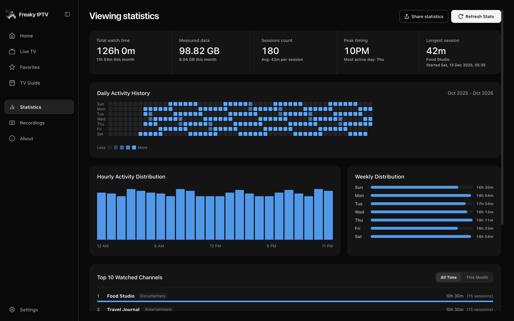

<p align="center">
  
</p>

<h1 align="center">Freaky IPTV</h1>

<p align="center">
  A free, open-source desktop player for watching live TV from your own IPTV playlist.
</p>

<p align="center">
  <strong><a href="https://github.com/guirosmaninho/freaky-iptv/releases/latest">Download the app</a></strong>
  ·
  <a href="https://freakyiptv.guirosmaninho.com/">Official website</a>
</p>

<p align="center">
  <sub>Windows x64 · macOS Apple Silicon and Intel</sub>
</p>

[](website/assets/app-previews/home.png)

## Get started

1. Pick a package from the [latest release](https://github.com/guirosmaninho/freaky-iptv/releases/latest).
2. Open **Settings** and add your M3U playlist URL. Add an XMLTV URL if you want programme listings.
3. Open **Live TV** to browse your channels or **TV Guide** to see what’s on.

| Platform | Downloads |
| :--- | :--- |
| Windows x64 | Installer or portable `.exe` |
| macOS Apple Silicon | `arm64` DMG or ZIP |
| macOS Intel | `x64` DMG or ZIP |

For installation help, including the first launch on macOS, see the [distribution guide](DISTRIBUTION.md). Freaky IPTV does not supply channels, playlists, programme guides or subscriptions.

## Explore the app

[](website/assets/app-previews/live.png)

| TV Guide | Viewing statistics |
| :--- | :--- |
| [](website/assets/app-previews/guide.png) | [](website/assets/app-previews/stats.png) |

Browse favourites and recent channels, set programme reminders, and review your viewing activity. The player supports HLS and MPEG-TS, with FFmpeg and LibVLC compatibility modes, Picture-in-Picture, frame capture and recording. Discord Rich Presence is optional.

## Privacy and support

The app keeps viewing history and recordings on your device and uses system-backed encryption for source credentials. Use a password-encrypted backup to move your settings between devices.

For reproducible bugs, [open a GitHub issue](https://github.com/guirosmaninho/freaky-iptv/issues/new). Keep private playlist and guide links, credentials and viewing data out of public reports. To report a vulnerability, follow the [security policy](SECURITY.md).

<details>
<summary>Local data folders</summary>

| Platform | Data folder |
| :--- | :--- |
| Windows | `%LOCALAPPDATA%\FreakyIPTV` |
| macOS | `~/Library/Application Support/FreakyIPTV` |

</details>

## Develop

Use Node.js `>=24.15 <25` with npm and the .NET 8 SDK for your build machine’s architecture. On macOS, install the Xcode command line tools.

```sh
git clone https://github.com/guirosmaninho/freaky-iptv.git
cd freaky-iptv
npm ci
npm run dev
```

The development command builds the native helpers and starts Vite and Electron.

| Command | What it checks |
| :--- | :--- |
| `npm test` | Unit and Electron host tests |
| `npm run lint` | ESLint |
| `npm run build:renderer` | TypeScript and renderer build |
| `npm run test:e2e` | Electron flows |

See the [architecture guide](docs/architecture.md), [CI workflow](.github/workflows/ci.yml), and [build and release instructions](DISTRIBUTION.md).

[MIT License](LICENSE) · [Third-party notices](THIRD_PARTY_NOTICES.md)
